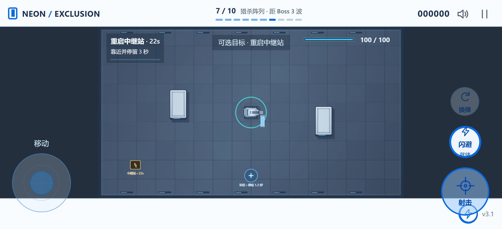

# 霓虹禁区 · v3.0

俯视角射击游戏。下载 [单文件离线版](offline/neon-exclusion.html)，保存后用浏览器打开即可游玩，无需安装依赖。推荐桌面浏览器或手机横屏。

在线试玩：[GitHub Pages](https://chijiachen2006.github.io/neon-exclusion/) · [备用地址](https://neon-exclusion-20261029.kasumi-c.chatgpt.site)。无需账号或 ChatGPT 登录。

## 作战流程

- 完成 10 波封锁即可通关。第 3、8 波出现精英，第 5 波是钢铁暴君，第 10 波是封锁主宰。
- 十波使用独立的敌人编队：接敌训练、交叉火力、精英试炼、突袭封锁、钢铁暴君、重整防线、猎杀阵列、精英围剿、最后防线、封锁主宰。后期组合冲锋者、狙击手和分裂者；第 6 波降低同时在场数量，作为 Boss 后的恢复波。
- 钢铁暴君使用扇形扫射、直线冲撞和近身震地；强攻击后装甲过热，受到伤害提高 45%。
- 封锁主宰有两个可摧毁的环绕护卫部件，每个提供 17.5% 减伤。使用锁定方向激光、定点轰炸和召唤；半血后加入留有安全缺口的环形弹幕。激光可借掩体阻挡，所有强攻击先预警再造成伤害。
- 普通敌人有 12% 概率掉落强化核心，首领必掉稀有核心。普通核心保留 25 秒，稀有核心不会过期。清波会自动收取剩余核心。
- 拾取核心后战斗暂停，三选一。普通核心升 1 级，稀有核心升 2 级，均不超过各自上限。普通波清波额外获得一次强化选择，并恢复 8 点生命。
- 通关后可带着当前构筑继续第 11 波无尽模式；菜单也会永久解锁从第 1 波开始的无尽模式。记录保存在当前浏览器。
- 每波清理后有 5 秒休整，Boss 波后 6 秒。休整时清除敌方弹幕和危险区，并刷新一次补给机会。

## 可选战斗目标

第 2 波限时补给箱、第 4 波悬赏精英、第 7 波重启中继站、第 9 波强化悬赏。目标在开波 4 秒后出现，限时 26 秒；补给箱靠近停留 0.8 秒，中继站累计驻守 3 秒，悬赏需击败金色标记敌人。完成可获得普通或稀有核心及额外分数，补给箱另恢复 15 点生命并补满弹匣。失败不阻止主线清波；无尽模式也会周期性出现可选目标。

## 16 种强化

大口径、穿透、极速射击、多重弹道、爆炸弹、弹射、电弧、冰冻弹、追踪弹、无人机、能量护盾、快速装填、扩容弹匣、闪避强化，以及互斥的重载机匣和轻量枪机。

重载机匣：伤害 ×1.70、射击间隔 ×1.28；轻量枪机：射击间隔 ×0.70、伤害 ×0.84。选择其中一项后，本局不会再提供另一项。

选择会优先提供已有强化的进阶和对应进化搭配，同时保留其他选择。满级和互斥技能不再出现。卡片显示选择后还缺哪些进化条件；每局可重抽 2 次，也可放弃当前核心恢复 12 生命。强化本局持续有效，重新开始会清空。

五种自动组合进化：

- 大口径 Lv.3 + 爆炸弹 Lv.3 → 榴弹炮，扩大爆炸范围与伤害。
- 极速射击 Lv.3 + 电弧 Lv.3 → 雷暴机枪，增加连锁目标与距离。
- 穿透 Lv.3 + 弹射 Lv.3 → 连锁穿甲弹，增加穿透目标和弹射次数。
- 冰冻弹 Lv.3 + 追踪弹 Lv.2 → 极寒追猎，对已减速敌人伤害提高 30%，追踪转向更快。
- 无人机 Lv.3 + 能量护盾 Lv.2 → 蜂群卫队，增加一架无人机，攻击间隔缩短 25%。

## 地图与提示

三套掩体布局随波次切换，掩体可阻挡双方子弹。第 4 波起普通战场会出现先预警、后生效的轰炸区域。每波有一个补给点，停留 1.2 秒恢复 20 点生命并补满弹匣，每波可使用一次。

角色旁保留竖直小弹夹，内部填充比例显示剩余弹量；低弹量变为警示色，装填时边框变青。顶部显示精确数字。普通波次提示使用小字、约 35% 不透明度背景，1.1 秒后淡出。

## 操作

- WASD / 方向键：移动。
- 鼠标瞄准，按住左键：射击。
- Space：闪避，R：装填。
- Esc / P：暂停或继续，M：静音。
- 强化选择时按 1 / 2 / 3，或点击相应卡片。
- 手机左侧使用可见的虚拟摇杆移动。右侧按住射击键连续开火并自动锁定可见敌人，拖动射击键可自由瞄准。
- 手机有独立闪避和换弹按钮；闪避跟随摇杆方向，按钮显示冷却进度。支持双指同时移动与射击。
- 松手、触控取消、暂停和切换横竖屏会释放触控状态，避免持续移动或开火。手机横屏使用两侧控件，竖屏使用下方控制区。

## 修改与运行源码

在本目录运行 `python -m http.server 8776`，再访问 `http://localhost:8776/`。源码使用 JavaScript 模块，需要通过本地服务运行。

运行 `python package.py` 可重新生成免服务、可双击打开的离线单文件。根目录可直接部署到 GitHub Pages 等静态网站服务。

运行 `node tests/game.test.cjs` 可执行无需额外依赖的游戏逻辑回归检查。浏览器检查另覆盖键鼠、手机双指操作、横竖屏强化界面和公开链接匿名游玩；自动检查不等同于完整人工平衡试玩。
